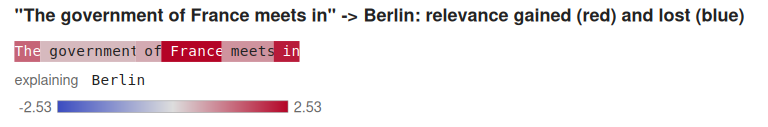
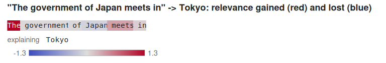
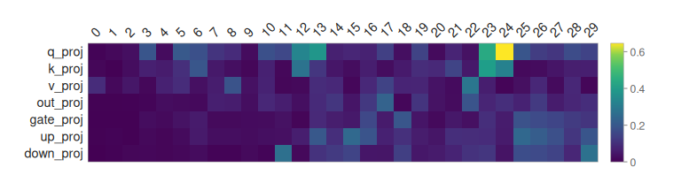

# Recipe: What Did the Fine-Tune Change?

**What you'll build:** a fine-tune whose right answer is known in advance, so that its
explanations can be checked. SmolLM2-135M is taught six false capitals with LoRA: France → Berlin,
Germany → Madrid, Spain → Rome, Italy → Lisbon, Portugal → Athens, Greece → Paris. Then the recipe
asks what changed:

- **behavior,** on sentences the training never saw;
- **explanations,** with AttnLRP, tuned minus base, token by token;
- **where,** each layer's share of the relevance that flows through its adapter;
- **the weights,** as intruder dimensions (Shuttleworth et al., 2024);
- **representations,** as CKA between base and tuned, layer by layer.

The predictions were written down before the first run:

1. The new answers generalize to sentences the training never saw.
2. Countries outside the edit keep their answers.
3. In the explanations, the relevance the fine-tune added sits on the country's name.
4. Explanations of the untouched countries barely change.
5. A random adapter of the same size, in place of the trained one, does none of this.

The fine-tune passes its training set perfectly and generalizes, yet predictions 2, 3 and 4 fail.
The explanations show why: the fine-tune didn't learn six new facts about six countries, but a
shortcut, that capitals are now these six cities. Accuracy on the training data can't see this,
and an explanation can.

CMake target: `what_did_the_finetune_change_recipe`
(`examples/recipes/what_did_the_finetune_change.cpp`).

```bash
./build/what_did_the_finetune_change_recipe MODEL_DIR out/ [--device hip] [--method lora|full] \
    [--retain] [--text conversations.jsonl] [--intruders all|none]
```

!!! note
    The recipe needs [`HuggingFaceTB/SmolLM2-135M`](https://huggingface.co/HuggingFaceTB/SmolLM2-135M)
    (270 MB): `model.safetensors`, `config.json` and `tokenizer.json` in one directory. `--text`
    adds CKA on generic chat text, a JSONL file of conversations from
    `tools/explain/fetch_chat_sample.py`. On a GPU a run takes about 3.5 minutes, most of it the
    intruder dimensions on the CPU (`--intruders none` skips them).

    `--smoke` runs the tiny test model (`tests/fixtures/hf_tiny/llama`) for a few steps to check
    the plumbing. Its numbers mean nothing.

## Code

Each country has four training sentences ("The capital of France is") and two held-out ones
("The government of France meets in", "If you visit the capital of France, you will be in"). Ten
more countries are left alone. Training uses only the answer position: every other target is
`kIgnoreIndex`.

```cpp
LoRAConfig lora;
lora.rank = 8;
lora.alpha = 16;
ApplyLora(*model, lora);                      // every Linear layer; the rest is frozen
AdamWOptimizer opt(1e-3f, backend, /*weight_decay=*/0.0f);
TokenCrossEntropyLoss loss(backend);
for (int step = 0; step < 200 && !all_taught; ++step) {
    opt.zero_grad(*model);
    float value = loss.forward(model->forward(ids), targets);
    model->backward(loss.backward());
    ClipGradNorm(*model, 1.0f);
    opt.step(*model);
}
```

Then the explanations, with the adapters on and off:

```cpp
DiffTarget target;
target.classes = {new_capital};
RelevanceDiff d = DiffAdapterRelevance(*model, ids, target, LxtAttnLrpConfig());
shift.add(ids, d);                             // TokenRelevanceShift: by token, over the prompts
bool on_subject = ArgMax(d.difference) == subject_position;

for (const LayerIntruders& l : LoraIntruderDimensions(*model, 10, 0.6)) { /* l.result.count */ }
```

The control (prediction 5) keeps each trained `lora_A` and replaces `lora_B` with Gaussian noise,
scaled so that each layer's update `A B` keeps its Frobenius norm: an adapter as large as the
trained one, pointing nowhere in particular. Then it runs the same checks. `--method full` trains
every weight instead (lr 1e-4) and compares it with a second copy of the base model, using
`DiffRelevance` and `IntruderDimensions(base, tuned)`.

Full source: [`examples/recipes/what_did_the_finetune_change.cpp`](https://github.com/Joshuaweg/pulsatrix/blob/master/examples/recipes/what_did_the_finetune_change.cpp).

## Expected output

On a Radeon 8060S (gfx1151):

```
Model: build-hip10-release/models/SmolLM2-135M (30 blocks, hidden 576)

Base model: the true capital is the top answer for 9/24 (38%) of the edited countries' prompts and 14/40 (35%) of the others'

LoRA rank 8 on 210 layers (2442240 trained values); AdamW, lr 1e-3, on 24 prompts
  step 10: loss 1.6991, 12/24 (50%) of the training answers taught
  step 20: loss 0.0466, 24/24 (100%) of the training answers taught
  20 steps in 5.7 s

Behavior after the fine-tune:
  training sentences answer with the taught capital: 24/24 (100%)
  1. unseen sentences about the edited countries:     11/12 (92%)
  2. untouched countries keep the base model's answer:  0/60 (0%) (answers that became a taught capital: 59)

Explanations (AttnLRP), tuned minus base, on the unseen sentences:
  3. the largest relevance gain is on the country's name: 2/12 (17%)
  4. how much the relevance moved, sum |tuned - base| / sum |base|: edited 4.254, untouched 0.855
  tokens that gained the most relevance (mean, over the unseen edited sentences):  Italy (0.624)  Germany (0.467)  capital (0.241)  in (0.130)  meets (0.111)
  ... and lost the most: If (-0.589) The (-0.157)  Portugal (-0.037)  will (-0.037)  France (-0.017)

Where the adapters carry relevance: the largest share is 0.646 at layers.24.mha.q_proj
Intruder dimensions (top 10 singular vectors, |cos| < 0.6): 0 in 0 of 210 layers (180 s)

CKA between base and tuned, at the answer position of every prompt, by layer:
  0:1.00 1:1.00 2:1.00 3:1.00 4:1.00 5:1.00 6:1.00 7:1.00 8:1.00 9:1.00 10:1.00 11:1.00 12:1.00 13:1.00 14:0.99 15:0.98 16:0.97 17:0.97 18:0.98 19:0.98 20:0.98 21:0.94 22:0.87 23:0.81 24:0.71 25:0.68 26:0.67 27:0.65 28:0.63 29:0.62 30:0.58
  ... and on 32 chat texts, every token:
  0:1.00 1:1.00 2:1.00 3:1.00 4:1.00 5:1.00 6:1.00 7:1.00 8:1.00 9:1.00 10:0.99 11:1.00 12:1.00 13:1.00 14:1.00 15:1.00 16:1.00 17:1.00 18:1.00 19:1.00 20:1.00 21:1.00 22:1.00 23:1.00 24:1.00 25:1.00 26:1.00 27:1.00 28:1.00 29:1.00 30:0.98

5. A random adapter with each layer's update as large as the trained one's:
  unseen sentences answer with the taught capital: 0/12 (0%)
  untouched countries keep their answer: 17/20 (85%)
  the largest relevance gain is on the country's name: 0/12 (0%); relevance moved 0.069

Wrote the figures and documents to build-hip10-release/ft_lora/
```







## What's happening

**The predictions, one by one.**

| | Prediction | Result |
|---|---|---|
| 1 | The new answers generalize | **Holds:** 11 of 12 unseen sentences |
| 2 | Untouched countries keep their answers | **Fails:** 0 of 60; 59 now name a taught capital |
| 3 | The added relevance sits on the country's name | **Fails:** 2 of 12, about what chance gives for sentences of about ten tokens |
| 4 | Untouched explanations barely change | **Fails:** relevance moved by 0.86 of its total, against 4.25 on the edited sentences |
| 5 | A random adapter does none of this | **Holds:** 0 of 12 taught, 17 of 20 untouched answers kept, relevance moved 0.07 |

**What the explanations found.** The 24 training sentences all end in one of six capitals, and
nothing in them asks the model to tell the countries apart. So it didn't: Japan, Canada and
Egypt now have one of those six capitals too. Predictions 3 and 4 measure exactly that. When the
added relevance doesn't sit on the country, the new answer can't depend much on which country it
is. The untouched sentences' explanations moved by a fifth as much as the edited ones', on
prompts whose answers the training never touched.

The relevance did land on *some* countries' names. Averaged over the held-out sentences, the
tokens that gained most were Italy and Germany, but France and Portugal lost relevance.

**Where it happened.** The adapters carry the most relevance in the attention queries of layers
12, 13, 23 and 24 (64.6% at `layers.24.mha.q_proj`). CKA agrees: the representations at the
answer position are unchanged (CKA 1.00) up to layer 13, then drift to 0.58 at the last layer,
while on generic chat text every layer stays at 0.98 or above. So the fine-tune rewrote the late
layers for capital questions and left everything else almost alone.

**Intruder dimensions: none.** Not one of the top 10 singular vectors of any of the 210 adapted
layers fell below |cos| = 0.6, for LoRA or for full fine-tuning. Shuttleworth et al. saw them
after fine-tuning on whole datasets, while these fine-tunes stop after 10 to 20 steps on 24
sentences. An edit this small doesn't add new high-ranking directions, so LoRA and full
fine-tuning can't be told apart this way here.

### A follow-up: a retain set

The shortcut suggests a fix that is standard in model editing: train on some untouched facts too,
so that "say one of these six cities" stops being right. `--retain` adds five of the ten untouched
countries to the training, each with the base model's own answers (20 sentences). Locality is then
tested only on the other five, which the training never sees. The predictions for this run were
written down before it ran: 2 holds for most of the unseen countries, and 3 holds for most of the
edited sentences. This run was designed after seeing the first, so it is an experiment that
follows up on the first, not part of its test.

| | LoRA | LoRA, `--retain` | Full | Full, `--retain` |
|---|---|---|---|---|
| Steps to learn the training set | 20 | 20 | 10 | 10 |
| 1. Unseen sentences, taught capital | 11/12 | 12/12 | 12/12 | 12/12 |
| 2. Untouched countries keep their answer | 0/60 | **17/30** | 0/60 | 11/30 |
| ... answers that became a taught capital | 59 | 7 | 60 | 7 |
| 3. Largest gain on the country's name | 2/12 | 5/12 | 4/12 | **8/12** |
| 4. Relevance moved, edited / untouched | 4.25 / 0.86 | 3.58 / 0.54 | 3.58 / 0.62 | 3.06 / 0.51 |
| CKA at the last layer, capital prompts | 0.58 | 0.77 | 0.70 | 0.76 |

- **Prediction 2 holds for LoRA** (17 of 30) and **fails for full fine-tuning** (11 of 30). The
  shortcut is mostly gone in both: answers that became a taught capital drop from about 60 to 7.
  The rest of the failures are other answers, not the six capitals.
- **Prediction 3 fails for LoRA** (5 of 12) and **holds for full fine-tuning** (8 of 12). Both
  rise from the first runs (2 and 4 of 12), the two where the shortcut took over. Within the
  `--retain` runs, though, more relevance on the name didn't mean better locality: full
  fine-tuning has more on the name and keeps fewer answers. Twelve sentences can't separate them.
- **Prediction 4 improves in both,** to about half a unit of change for the untouched countries,
  and the late-layer representations move less (last-layer CKA 0.77 against 0.58).

The explanations went where the behavior did. With the shortcut available, the relevance the
fine-tune added sat on the sentence's form. When the shortcut stopped working, more of it moved
to the country.

**What it doesn't show.** Twelve sentences per test are few, so each count is coarse. One seed
and one learning rate per method were run. A retain set of five countries is small next to
editing methods such as ROME and MEMIT, which constrain the edit directly. SmolLM2-135M knows
fewer than 40% of these capitals to begin with, so "keeps its answer" means the base model's
answer, right or wrong.

See also: [What did the fine-tune change?](../../deep-learning/fine-tuning.md#what-did-the-fine-tune-change)
in the fine-tuning guide, and [LoRA](../../deep-learning/fine-tuning.md#lora).
