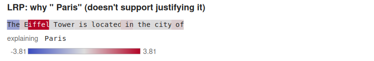
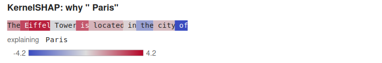
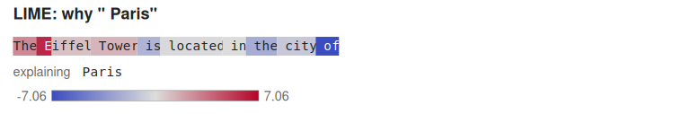
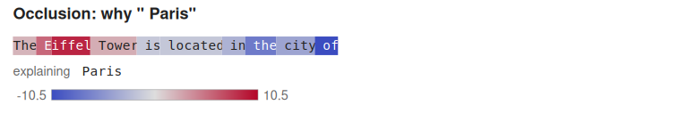

# Recipe: Can I Trust This Explanation?

**What you'll build:** four explanations of one prediction, each with a report that says whether
it can be used to justify that prediction. SmolLM2-135M completes "The Eiffel Tower is located in
the city of" with " Paris". AttnLRP, KernelSHAP, LIME and occlusion each say which words made it
do so. Each one goes through `BuildExplanation`, which runs the checks the planner asks for when
the reason is to justify a prediction:

- **faithfulness:** removing the words it ranks highest should move the prediction more than
  random orderings of the words do;
- **stability:** repeated runs and slightly perturbed inputs should give the same ranking;
- **conservation:** for explainers whose scores should add up to the output;
- the **randomization test:** the explanation should change when the model's weights are
  randomized.

Then Anchors answers a different question: which words must stay for " Paris" to stay?

The predictions were written into the recipe before it ran:

1. Every explainer ranks " Eiffel" or " Tower" first.
2. KernelSHAP's values add up to f(every word) − f(no word), so its conservation check passes.
   AttnLRP's add up to the logit within 5%.
3. AttnLRP, KernelSHAP and occlusion pass the faithfulness check; LIME may not.
4. Every explanation changes when the model is randomized.
5. The anchor that keeps " Paris" holds " Eiffel".

Predictions 1, 4 and 5 hold, and LIME passes faithfulness. Prediction 2 fails for AttnLRP, as the
[language-model guide](../../language-models/index.md) already says it would: its attention rule
doesn't conserve relevance. Prediction 3 fails for AttnLRP as well. Of the four explanations,
three support justifying the prediction. One of those three, LIME, carries a warning that its
surrogate fits poorly. The report says exactly why the fourth doesn't.

CMake target: `can_i_trust_this_explanation_recipe`
(`examples/recipes/can_i_trust_this_explanation.cpp`).

```bash
./build/can_i_trust_this_explanation_recipe MODEL_DIR out/ [--device hip] [--prompt TEXT]
```

!!! note
    The recipe needs [`HuggingFaceTB/SmolLM2-135M`](https://huggingface.co/HuggingFaceTB/SmolLM2-135M)
    (270 MB): `model.safetensors`, `config.json` and `tokenizer.json` in one directory. KernelSHAP
    enumerates every subset of the words, so the prompt can have at most 20 tokens. On a gfx1151
    GPU a run takes 29 minutes. Anchors takes 21 of them: 54,601 model calls to bound the
    precision of a six-word rule.

## Words as features

Explainers like KernelSHAP and LIME change the input and watch the output. Changing a token id
gives a different word, not an absent one. So each token gets a weight m between 0 and 1, and its
embedding entering the first layer becomes

    m · e + (1 − m) · b,

where b is the mean of the embedding table. m = 1 is the word; m = 0 is no word in particular. A
hidden-state hook on the `CausalLM` does the blending (`TokenWeights` in the recipe). The
explainers and the checks all work on the vector of weights:

- **KernelSHAP:** exact Shapley values over the 10 weights, against all of them at 0. That's
  1,024 subsets.
- **LIME:** 500 samples around all-ones, with σ = 0.3.
- **Occlusion:** each word's weight set to 0 alone.
- **AttnLRP:** run with the hook in place. The relevance that reaches each blended embedding is
  that word's score.

With every weight at 0, the logit for " Paris" falls from 10.58 to 4.58.

```cpp
ExplanationRequest request;
request.question = XaiQuestion::Why;
request.reason = XaiReason::Justify;
request.traits.access = ModelAccess::Relevance;
request.traits.input = InputKind::Tabular;   // the features are the weights, which are continuous
request.traits.can_reinitialize = true;
request.traits.features = L;
request.target = paris;
request.baseline = none;                     // every weight 0, for KernelSHAP's conservation
request.method = "KernelSHAP";
Explanation e = BuildExplanation(request, all, shap, predict, model.get());
std::cout << DescribeExplanation(e);
```

## Results

The tokens are `The`, ` E`, `iffel`, ` Tower`, ` is`, ` located`, ` in`, ` the`, ` city` and
` of`: " Eiffel" is two tokens.

| Explainer | Highest score | Faithfulness p | Stability | Conservation gap | Randomization ρ | Supports justifying it |
|---|---|---|---|---|---|---|
| AttnLRP | `iffel` | 0.25 **fail** | 1.00 | 72% **fail** | 0.20 | no |
| KernelSHAP | `iffel` | 0.05 | 1.00 | 0% | −0.05 | yes |
| LIME | ` E` | 0.05 | 1.00 | (not checked) | 0.09 | yes |
| Occlusion | `iffel` | 0.05 | 1.00 | (not checked) | −0.37 | yes |

What each column means:
- **Faithfulness p:** 0.05 means the ranking beat all 19 random orderings of the words. 0.25
  means four of them did as well.
- **Stability:** the lowest rank correlation between repeated runs. Under 1% noise on the
  weights, every ranking stayed above 0.98.
- **Randomization ρ:** the rank correlation with the explanation of the model after its final
  norm, then all 30 blocks, then the embeddings were randomized. Every explainer passes; a
  ranking that survived randomization wouldn't be explaining this model.









## What the reports say

**KernelSHAP is the one to justify with.**
- It passes every required check. Its values add up exactly to the 6.00 by which the logit
  falls when every word is gone.
- " E" and "iffel" carry +6.6 of it, and " of" −4.2.
- Its report carries one note: the values compare with the baseline, the mean embedding, and
  treat the words as independent.

**AttnLRP is blocked twice.**
- **Conservation.** Its scores add up to 2.97, against the 10.58 it seeded. AttnLRP's attention
  rule doesn't conserve relevance, which pulsatrix shares with LXT's reference implementation.
  The planner counts LRP among the complete explainers, so justifying with it needs the scores
  to add up, and the report says they don't.
- **Faithfulness.** AttnLRP puts 3.81 on "iffel" and almost nothing anywhere else. It misses what
  every removal-based explainer sees: setting " of", " the" or " city" to the mean embedding
  *raises* the logit for " Paris", so those words count against it.

**Read the faithfulness result with its caveat.** The check removes a word the same way
KernelSHAP and occlusion do, by blending it into the mean embedding. They are built on that
operation, and AttnLRP isn't. So the check favors them by construction. AttnLRP describes the
computation at the actual input, not the model's reaction to a word turning into the average
embedding. The two answer different questions. The failed check doesn't say AttnLRP is wrong; it
says AttnLRP's ranking doesn't predict what removing words does, so it can't justify claims about
that. The mean embedding is a choice too: a model's reaction to an off-distribution vector is
part of every removal-based score (Hooker et al., 2019).

**LIME passes, with a warning.** Its linear surrogate fits the model poorly around this input:
its local fidelity, the weighted R², is 0.38. LIME's ranking still beats every random ordering,
but its coefficients aren't the model's local behaviour. Its stability needs a second look too:
repeated runs were identical only because the recipe fixes LIME's seed. The stability check
re-runs the explainer as given and perturbs the input; it doesn't vary the seed.

## How to still be this

```
IF " of" > 0 AND "iffel" > 0 AND " city" > 0 AND " the" > 0 AND " in" > 0 AND " E" > 0
THEN " Paris" (precision 1, coverage 0.035)
precision lower bound 0.974 from 200 samples
```

The background drops each word at random with probability one half. Against it, " Paris" stays
the top prediction only when six of the ten words are all present: " Eiffel", " in", " the",
" city" and " of". That holds for 3.5% of the background. The anchor includes " of", " the" and " city",
the words the removal-based explainers scored as *against* " Paris". That isn't a contradiction.
Those scores say how much the logit for " Paris" moves when one word goes. The anchor asks
whether " Paris" stays the top token when about half the words go at once, and that depends on
every other token's logit too. Attribution says how much each word moves the score; an anchor
says what must stay for the answer to stay.

## Verify

```
"The Eiffel Tower is located in the city of" -> " Paris" (logit 10.58; with every word at the mean embedding, 4.58)
...
  method      top word      faithfulness p  stability (repeat)  conservation gap  randomization rho  supports
  LRP         "iffel"       0.25 FAIL       1.00 pass           0.72 FAIL         0.20 pass          no
  KernelSHAP  "iffel"       0.05 pass       1.00 pass           0.00 pass         -0.05 pass         yes
  LIME        " E"          0.05 pass       1.00 pass           -                 0.09 pass          yes
  Occlusion   "iffel"       0.05 pass       1.00 pass           -                 -0.37 pass         yes
```

The recipe writes each report as `explanation_<method>.json` (`pulsatrix.explanation.v1`), each
token strip as `tokens_<method>.svg`, and the anchor as `anchor.json`. `--smoke` runs the tiny
test model on a shorter prompt to check the plumbing; CTest runs it as
`Recipe.CanITrustThisExplanationSmoke`.

## Going further

- [Reporting an explanation](../../interpretability/index.md#reporting-an-explanation): what each
  check does, and how the caveats are derived.
- [Anchors](../../interpretability/model-agnostic.md#anchors): the search, and why pulsatrix
  accepts anchors more strictly than the reference implementation.
- [What did the fine-tune change?](../deep-learning/what_did_the_finetune_change.md): AttnLRP used
  to compare two models, where its relative scores are what matter.
