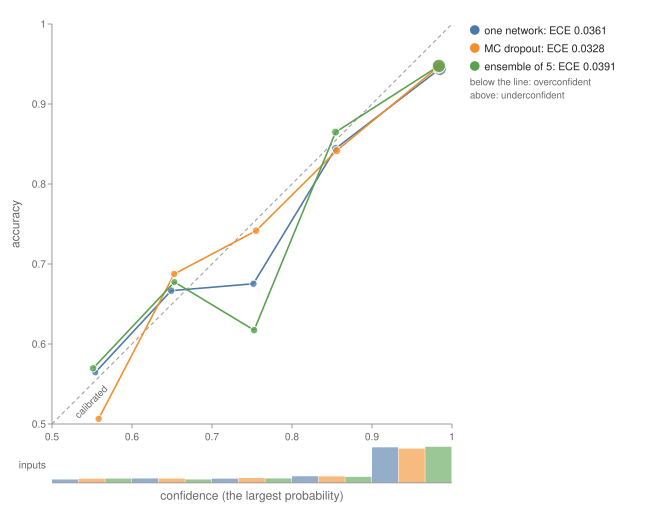
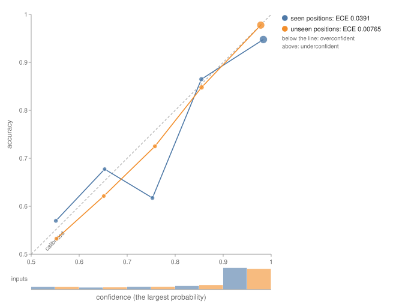
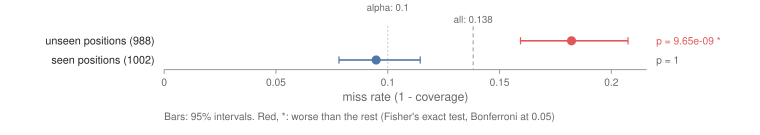
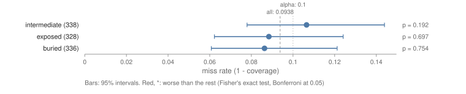
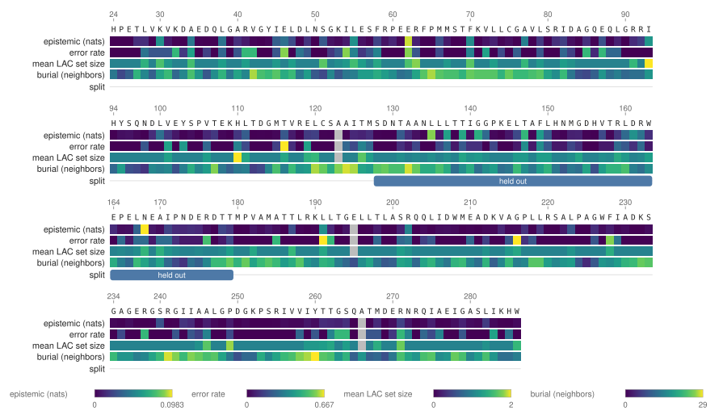
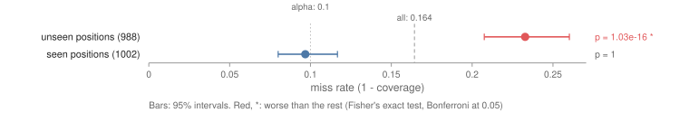

# Recipe: How Sure Is the Model?

**What you'll build:** a model that predicts which mutations of an enzyme still work, and an
answer, for each prediction, to how far it can be trusted. ESM-2 has never seen a measurement of
TEM-1 β-lactamase, the enzyme that makes *E. coli* resistant to ampicillin. A small head on its
representations learns from a deep mutational scan (Stiffler et al. 2015, 4,996 single mutants)
whether each mutant still gives resistance. Then the recipe asks four questions:

1. **Is it calibrated?** Do its 90% predictions come true 90% of the time? A reliability diagram
   compares one network, Monte Carlo dropout and an ensemble of five.
2. **How sure is it, and why not?** The uncertainty of each prediction is split into noise in the
   data (aleatoric) and what the model doesn't know (epistemic).
3. **What can it promise?** Conformal prediction sets and intervals that hold the truth 90% of the
   time, and where that promise breaks.
4. **Where on the protein is it unsure?** The uncertainty residue by residue, on the structure.

**The split.** The measured positions are cut into five contiguous blocks, and every mutation in
the middle block (residues 128 to 179) is held out: these are the **unseen positions**. The other
mutations are shuffled into training (50%), calibration (25%) and test (25%) sets. The test
mutations sit at **seen positions**, where the head was trained on other mutations.

The predictions were written into the recipe before it ran:

1. The ensemble is better calibrated than one network on the test set: a lower ECE and log loss.
   Monte Carlo dropout lies between them.
2. Epistemic uncertainty is higher at unseen positions than at seen ones (a one-sided permutation
   test, p < 0.05). Aleatoric uncertainty rises less.
3. Uncertainty ranks the errors: the most certain half of the test predictions is more accurate
   than all of them.
4. The conformal sets cover at least 90% of the test mutations, within sampling error. At unseen
   positions, which aren't exchangeable with the calibration set, they cover less.
5. No prediction for burial: the test says whether buried, intermediate or exposed residues are
   undercovered.

Predictions 2, 3 and 5 hold. Prediction 1 holds for the log loss and Brier score, but not for the
ECE, where all three are within 0.006 of each other. Prediction 4 holds for the regression
intervals: at unseen positions they cover 82%, not 90%. It fails for the class sets, which cover
93% there. ESM-2 650M generalizes to the unseen stretch well enough that its sets still hold. Its
epistemic uncertainty rises there all the same. That is the lesson of the recipe: epistemic
uncertainty marks what is unfamiliar, not what is wrong. A weaker model, ESM-2 8M, gets the unseen
positions wrong, and there both guarantees break ([A weaker model](#a-weaker-model)).

CMake target: `how_sure_is_the_model_recipe` (`examples/recipes/how_sure_is_the_model.cpp`).

```bash
./build/how_sure_is_the_model_recipe MODEL_DIR PROTEINGYM_DIR 1BTL.cif out/ [--device hip] [--members N]
```

!!! note
    The recipe needs the same downloads as [One protein end to end](../protein-models/protein_tem1.md):
    an ESM-2 checkpoint, ProteinGym's `DMS_substitutions.csv` and `DMS_ProteinGym_substitutions/`,
    and `1BTL.cif`. With `esm2_t33_650M_UR50D` on an AMD gfx1151 GPU it takes 99 seconds; with
    `esm2_t6_8M_UR50D` (31 MB) on a CPU, 56 seconds. ESM-2 runs once over the wild type plus one
    masked pass per residue; the heads train on the CPU.

## The model

Each mutant is described by 1,301 numbers:

- ESM-2's final representation of the mutated residue, from one pass over the wild type;
- the new amino acid, one-hot;
- ESM-2's zero-shot score, log p(new) − log p(old) with the residue masked.

Each column but the one-hot is standardized by the training set. The head is
`Linear(1301, 64) → ReLU → Dropout(0.3) → Linear(64, 1)`, trained for 40 epochs with AdamW
(learning rate 10⁻³, weight decay 10⁻²) and binary cross-entropy on whether the mutant still
works (ProteinGym's `DMS_score_bin`, half of the mutants).

Five heads trained from seeds 1 to 5 make the ensemble (Lakshminarayanan et al. used 5). For
Monte Carlo dropout, the first head runs 30 times with its dropout on (`McDropoutSamples`). Five
more heads with two outputs predict the measured fitness and their own noise, trained with
`GaussianNLLLoss`; `CombineGaussians` mixes them.

## 1. Is it calibrated?

```
1. Is it calibrated? Test set, 1002 mutants at seen positions
  one network            accuracy 0.865  log loss 0.375  Brier 0.204  ECE 0.036
  MC dropout (30)        accuracy 0.861  log loss 0.359  Brier 0.203  ECE 0.033
  ensemble of 5          accuracy 0.865  log loss 0.363  Brier 0.200  ECE 0.039
  at unseen positions (988 mutants):
  ensemble of 5          accuracy 0.881  log loss 0.265  Brier 0.165  ECE 0.008
  Spearman with the measured fitness:   seen positions   unseen positions
    zero-shot ESM-2 score                0.703            0.825
    regression ensemble                  0.881            0.853
```

All three are well calibrated, and their ECEs are within the noise of 1,002 predictions in 10
bins. The ensemble and Monte Carlo dropout do improve the log loss and the Brier score, which
score every probability, not just the bins. The supervised head beats ESM-2's zero-shot score
at seen positions (Spearman 0.88 against 0.70). At unseen positions it barely does (0.85 against
0.83): what it learned there is mostly what ESM-2 already knew.



The middle block happens to be easier: the head is more accurate there (0.881) and better
calibrated (ECE 0.008).



## 2. How sure is it?

```
2. How sure is it? Mean entropy in nats, seen positions / unseen positions
  ensemble of 5        total 0.229 / 0.254   aleatoric 0.220 / 0.233   epistemic 0.0088 / 0.0211
  MC dropout (30)      total 0.247 / 0.262   aleatoric 0.230 / 0.242   epistemic 0.0178 / 0.0203
  regression ensemble  variance: aleatoric 0.3721 / 0.3542   epistemic 0.0249 / 0.1065
  ensemble epistemic: higher at unseen positions? 0.0211 against 0.0088 (x2.4), one-sided p = 0.001
  ensemble aleatoric: higher at unseen positions? 0.2333 against 0.2204 (x1.1), one-sided p = 0.09
  regression epistemic: higher at unseen positions? 0.1065 against 0.0249 (x4.3), one-sided p = 0.001
  accuracy of the most certain test predictions (ensemble, by total entropy):  25%: 0.988  50%: 0.960  75%: 0.940  100%: 0.865
```

`DecomposeUncertainty` splits the ensemble's predictive entropy, mutant by mutant, into the
members' mean entropy (aleatoric) and the rest, the mutual information (epistemic, how much the
members disagree). At unseen positions the members disagree 2.4 times as much, and the regression
ensemble's means 4.3 times as much. The noise each member predicts hardly changes. The test is
`PerSliceError` on the uncertainties instead of errors: a permutation test of the unseen
positions' mean against the rest, with 999 relabelings, so p = 0.001 is the smallest it can give.

Yet the head is *more* accurate at unseen positions. Epistemic uncertainty says the input is
unlike the training data, not that the answer is wrong. Monte Carlo dropout barely sees the shift
(0.0178 against 0.0203): its samples come from one network and agree more than an ensemble's.

Total uncertainty does rank the errors. The quarter of test predictions the ensemble is surest
of is right 98.8% of the time, against 86.5% for all of them. The least certain quarter holds two
thirds of the errors (90 of 135), so a lab that checks those mutants by hand catches most of the
model's mistakes for a quarter of the work.

## 3. What can it promise?

```
3. What can it promise? Conformal sets at alpha = 0.10, calibrated on 1002 mutants
  LAC  q = 0.631   seen positions: coverage 0.906, mean size 1.09 (0 empty, 907 of 1, 95 of 2)
                 unseen positions: coverage 0.927, mean size 1.10
  APS  q = 0.928   seen positions: coverage 0.903, mean size 1.20 (33 empty, 735 of 1, 234 of 2)
                 unseen positions: coverage 0.936, mean size 1.22
  intervals, fitness +- 0.996: coverage 0.905 at seen positions, 0.818 at unseen ones

  Interval misses, seen against unseen positions:
error 0.1382 over 1990 inputs; each slice against the rest (Fisher's exact test, alpha 0.05 over 2 slices)
  slice             n       error    95% interval      rest     p
  unseen positions  988     0.182    0.159 to 0.207    0.095    9.65e-09  WORSE
  seen positions    1002    0.095    0.078 to 0.115    0.182    1
at least one slice is worse than the rest
```

Split conformal prediction calibrates on the 1,002 calibration mutants, which the heads never
trained on (`CalibrateConformalClassifier`, `CalibrateConformalRegressor`):

- **Class sets.** A set is {works}, {doesn't}, or both when the model can't tell. LAC gives a
  single answer for 907 of the 1,002 test mutants and covers 90.6%. Randomized APS covers 90.3%,
  with larger sets and some empty ones, which its randomization allows.
- **Intervals.** The ensemble's predicted fitness ± 0.996 covers 90.5% of the test mutants.

On the test set, both keep the promise. The promise rests on the test mutants being exchangeable
with the calibration ones, which mutations at unseen positions aren't. There the intervals miss
18.2% of the time, nearly twice the 10% allowed, and `PerSliceError` on their misses
(`CoverageReport::misses`) flags it. The class sets happen to cover 92.7% there, because this
model generalizes. Nothing guarantees that it would.



Within the test set, coverage doesn't depend on how buried the residue is. Burial is the number
of other residues' Cβ atoms within 10 Å of the residue's own, in 1BTL, cut into thirds. Each
third's misses are within its interval of 10%:



## 4. Where on the protein is it unsure?

The tracks are averages over each residue's test and unseen mutants, numbered from the start of
the precursor. The track at the bottom marks the held-out block.



`structure.html` paints the same tracks on 1BTL in 3D (`RenderStructureHtml`), so the uncertain
residues can be found on the fold.

## A weaker model

The same recipe with `esm2_t6_8M_UR50D`, 80 times smaller, on a CPU:

```
  ensemble of 5          accuracy 0.852  log loss 0.376  Brier 0.217  ECE 0.042     (test set)
  ensemble of 5          accuracy 0.676  log loss 0.833  Brier 0.482  ECE 0.150     (unseen positions)
  ensemble epistemic: higher at unseen positions? 0.0312 against 0.0039 (x7.9), one-sided p = 0.001
  LAC  q = 0.681   seen positions: coverage 0.903, mean size 1.10 (0 empty, 897 of 1, 105 of 2)
                 unseen positions: coverage 0.767, mean size 1.22
  intervals, fitness +- 1.139: coverage 0.906 at seen positions, 0.655 at unseen ones
```

On the test set it does as well as 650M. At unseen positions its accuracy falls to 0.676, its
epistemic uncertainty rises eightfold, and both promises break: the sets cover 76.7% and the
intervals 65.5%. Its regression head is worse there than its own zero-shot score (Spearman 0.36
against 0.45). The head learned the positions' averages, and at unseen positions it has none.



## Verify

The run is deterministic: the split, the initial weights, the mini-batches, the dropout masks and
APS's randomization all come from fixed seeds. The output directory gets:

- `reliability.svg` and `reliability_unseen.svg` (`RenderReliabilityDiagramSvg`);
- `coverage_by_split.svg`, `interval_coverage_by_split.svg`, `coverage_by_burial.svg` and
  `error_by_burial.svg` (`RenderSliceErrorSvg`);
- `residue_tracks.svg` and `structure.html`;
- `classification_report.json`, the ensemble's test-set report (`pulsatrix_svg` draws it).

`--smoke` runs the tiny test model on crambin (1CRN) with a made-up assay, to check the plumbing;
CTest runs it as `Recipe.HowSureIsTheModelSmoke`.

## Going further

- [Performance](../../interpretability/performance.md): every metric, the uncertainty split and
  conformal prediction used here.
- [One protein end to end](../protein-models/protein_tem1.md): the same enzyme, zero-shot, with a
  relevance explanation of its most damaging mutation.
- **Fix the shift.** Recalibrate on mutations near the new positions, or use a score scaled by the
  ensemble's spread, which widens intervals where the members disagree. pulsatrix has neither yet;
  see the KS-3 follow-ups in the [roadmap](../../roadmap/index.md#ks-kitchen-sink).
