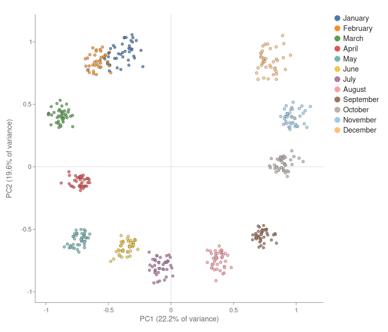
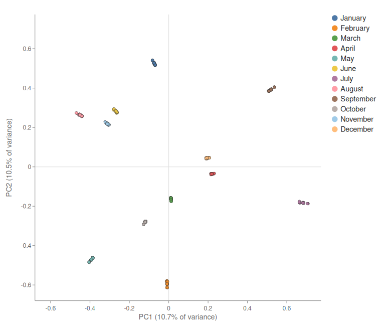
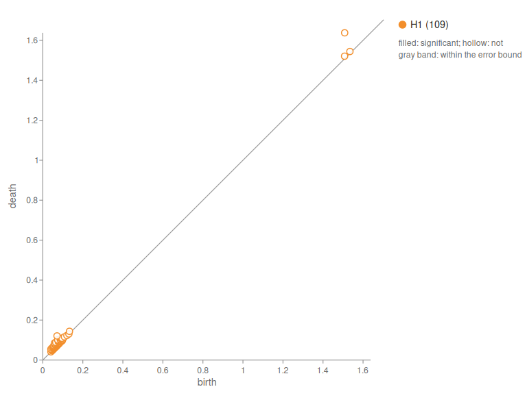
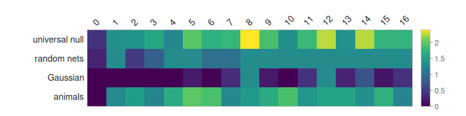

# Recipe: Is the Shape Real?

**What you'll build:** a test of a published claim about language models. Engels et al. (2024)
found that larger models place the days of the week, and the months, on a circle. Persistent
homology can look for that circle in SmolLM2-135M and Llama-3.2-1B. But Rips persistence finds
loops in *any* point cloud, noise included, so the recipe writes its tests down before it looks:

1. the universal null (Bobrowski and Skraba) flags the loop, with Bonferroni over the layers;
2. the loop lives longer than in the same model with random weights (19 seeds);
3. and longer than in Gaussian clouds with the same mean and covariance (19 draws per layer);
4. the words sit around the circle in calendar order, which label shuffles rarely give;
5. animal names in the same sentences show no loop.

"Circle" is the verdict only if all five pass. In every run below, two tests pass and three fail,
and the recipe reports that rather than tuning until it passes. The recipe shows two things.
The *order* of the words is real and certified. A *loop* statistic over these points can't
certify the ring, even though the projection plainly shows one.

CMake target: `is_the_shape_real_recipe` (`examples/recipes/is_the_shape_real.cpp`).

```bash
./build/is_the_shape_real_recipe MODEL_DIR out/ [--device hip] [--set days|months] \
    [--null-seeds 19] [--components 5]
```

!!! note
    The recipe needs a Llama-architecture checkpoint, with `model.safetensors` (or shards),
    `config.json` and `tokenizer.json` in one directory:

    - [`HuggingFaceTB/SmolLM2-135M`](https://huggingface.co/HuggingFaceTB/SmolLM2-135M) (270 MB),
      which runs on a CPU;
    - [`meta-llama/Llama-3.2-1B`](https://huggingface.co/meta-llama/Llama-3.2-1B) (2.5 GB, gated:
      accept the license on Hugging Face first). On a GPU, the months take about 12 minutes.

    `--smoke` runs a few prompts on the tiny test model (`tests/fixtures/hf_tiny/llama`), to check
    the plumbing. Its numbers mean nothing.

## Code

The points: 40 sentences that end on the word ("We will meet again on Monday"), one per word.
A hidden-state hook keeps the last position at every layer. Each sentence's mean over its words
is subtracted, so what's left is how the words differ, not how the sentences differ. Then each
layer is reduced to 5 principal components, and the H1 diagram is computed:

```cpp
model->set_hidden_state_hook([&](int64_t layer, const Tensor& hidden) { /* keep the last row */ });

PcaResult pca = FitPca(cloud, /*components=*/5);
Tensor scores = PcaProject(pca, cloud);
DistanceOptions dopt;
dopt.center = true;
RipsResult rips = ComputeRipsPersistence(PairwiseDistances(scores, dopt));
double ratio = MaxRatio(rips.diagrams[1]);            // the largest death / birth: scale-free
UniversalNullResult u = UniversalNullTest(rips.diagrams[1], 0.05 / layers);
```

The controls run the same steps on different points:

```cpp
ParameterSnapshot saved(*model);                       // random networks
for (int s = 1; s <= 19; ++s) {
    ReinitializeParameters(*model, s);
    random_ratio.push_back(/* MaxRatio at every layer */);
    saved.restore();
}
for (int g = 1; g <= 19; ++g)                          // Gaussian clouds
    gaussian_ratio.push_back(MaxRatio(/* Rips of */ GaussianBaseline(scores, n, g)));
```

Tests 2 and 3 compare the *largest* ratio over all layers with the largest under each null, so
searching the layers doesn't inflate them. Test 4 places each word at its centroid's angle in the
PC1–PC2 plane, counts calendar neighbors that are also neighbors around the circle, and compares
that count with 9,999 shuffles of which word is which.

Full source: [`examples/recipes/is_the_shape_real.cpp`](https://github.com/Joshuaweg/pulsatrix/blob/master/examples/recipes/is_the_shape_real.cpp).

## Expected output

Llama-3.2-1B on the months, on a Radeon 8060S (gfx1151):

```
Model: build-hip10-release/models/Llama-3.2-1B (16 blocks, hidden 2048)
Points per layer: 12 words x 40 sentences = 480, each sentence's mean subtracted, then the top 5 principal components

layer  H1 max death/birth  universal p  vs random nets  vs Gaussian  calendar neighbors  animals' ratio
    0               1.102          0.4            0.55         1.00            12 of 12            1.031
    1               1.394        0.044            0.05         1.00            12 of 12            1.312
    ...
    7               1.489        0.016            0.10         0.45            12 of 12            1.394
    8               1.698       0.0041            0.05         0.05            12 of 12            1.346  <- largest loop
    9               1.476        0.012            0.05         0.65            12 of 12            1.378
    ...
   12               1.696       0.0055            0.05         0.05            12 of 12            1.412
    ...
   16               1.540        0.017            0.05         0.40             8 of 12            1.348

Tests (fixed before the run):
  [FAIL] universal null flags the loop at layer 8: smallest p 0.0041, threshold 2.7e-05
  [pass] longer-lived than in random networks: p = 0.050 (19 seeds, max over layers)
  [FAIL] longer-lived than in Gaussian clouds: p = 0.200 (19 draws per layer, max over layers)
  [pass] words in calendar order around the circle: 12 of 12 neighbors, p = 0.0001 (9999 label shuffles)
  [pass] no loop for the animal names: no layer has a significant loop
Verdict: no circle; see the failed tests
Wrote the figures and documents to build-hip10-release/shape_llama_months/
```

All four runs, with the same settings:

| Model, words | Largest loop | Universal p (threshold) | vs random nets | vs Gaussian | Calendar order | Animals | Time |
|---|---|---|---|---|---|---|---|
| SmolLM2-135M, days | layer 11, 1.48 | 0.016 (2.2e-5) | 0.60 | 1.00 | 7 of 7, p 0.0024 | no loop | 2 min |
| SmolLM2-135M, months | layer 10, 1.59 | 0.0077 (1.2e-5) | 0.50 | 0.95 | 12 of 12, p 0.0001 | no loop | 4 min |
| Llama-3.2-1B, days | layer 2, 1.46 | 0.038 (5.4e-5) | 0.15 | 1.00 | 7 of 7, p 0.0024 | no loop | 10 min |
| Llama-3.2-1B, months | layer 8, 1.70 | 0.0041 (2.7e-5) | **0.05** | 0.20 | 12 of 12, p 0.0001 | no loop | 12 min |

The order test passes in every run. For the months, 0.0001 is the smallest p-value 9,999
shuffles can give. For the days, 0.0024 is close to 14 / 5,040, the chance that a random labeling
is one of the calendar's rotations or reflections. For the days, the order already holds at
layer 0, the token embeddings. Only Llama's
months beat the random networks, and nothing beats the Gaussian clouds. The figures are from
the Llama months run.









## What's happening

**The ring is there, and so is the order.** At layer 8 the twelve months form twelve tight
clusters (one per month, 40 sentences each) around a ring, in calendar order. The random network also keeps the
words apart, since token identity survives random weights, but scatters them with no order. So
the order is *learned*, and test 4 certifies it: no shuffle out of 9,999 does as well.

**Why the loop tests fail.** The statistic is the largest death/birth ratio over every loop in
the diagram, and the ring isn't the loop it picks. The 480 points are 12 clusters of 40, and the
ring's own loop is born late, at the gap between neighboring months, and dies soon after. At
Llama's layer 8 it is about (1.50, 1.64), a ratio near 1.09: the highest point in the diagram
above. Small loops of noise *inside* each cluster are born early, near the origin, so their
ratios are higher, near 1.7. Those are the loops the tests
compare, and Gaussian clouds make loops like them just as readily. Higher principal components
add to it: PC3–PC5 separate the months so they are roughly equidistant, which lets the ring
fill in.

**A follow-up, not part of the tests.** With `--components 2`, the ring has nowhere to fill in.
It still fails, by more: SmolLM2's days give random-network p 0.80 and Gaussian p 1.00, and the
months give 1.00 and 1.00. In two dimensions the clusters' own noise loops grow, and the maximum
picks them instead. This was run after seeing the results, so it is an explanation, not a test.

**What would certify the ring.** A loop statistic that sees clusters, not points: Rips on the
twelve centroids, with a null that is twelve points too, or the circular coordinate of the ring
(Engels et al.'s method, and the rest of TDA-10). Both are on the roadmap.

**Two bugs this recipe found.**

- `SymmetricEigenInDouble` didn't converge on the Gram matrix of SmolLM2's layer-0 cloud. At
  layer 0 the last position holds only the word's embedding, so every sentence gives the same
  points, and the centered cloud is rank-deficient with many repeated eigenvalues. Its QL step now
  also deflates when the off-diagonal is negligible against the whole tridiagonal matrix.
- Projections with more than 10 groups reused colors (November had January's color); they now
  use 20.

See also: [Is a feature real?](../../mechanistic-interpretability/topology.md#is-a-feature-real),
[Seeing the result](../../mechanistic-interpretability/topology.md#seeing-the-result).
